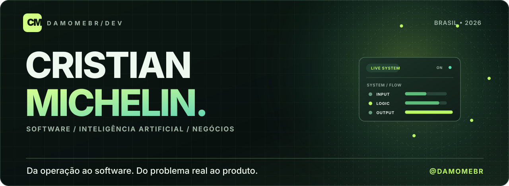
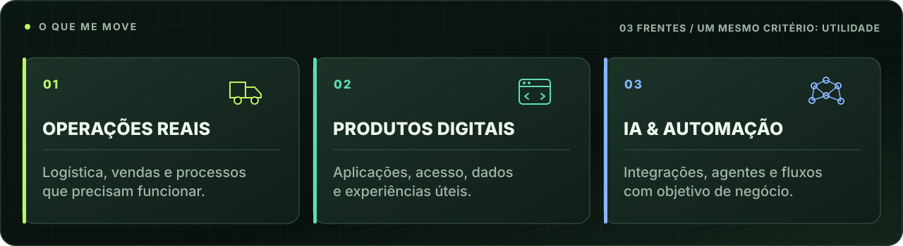
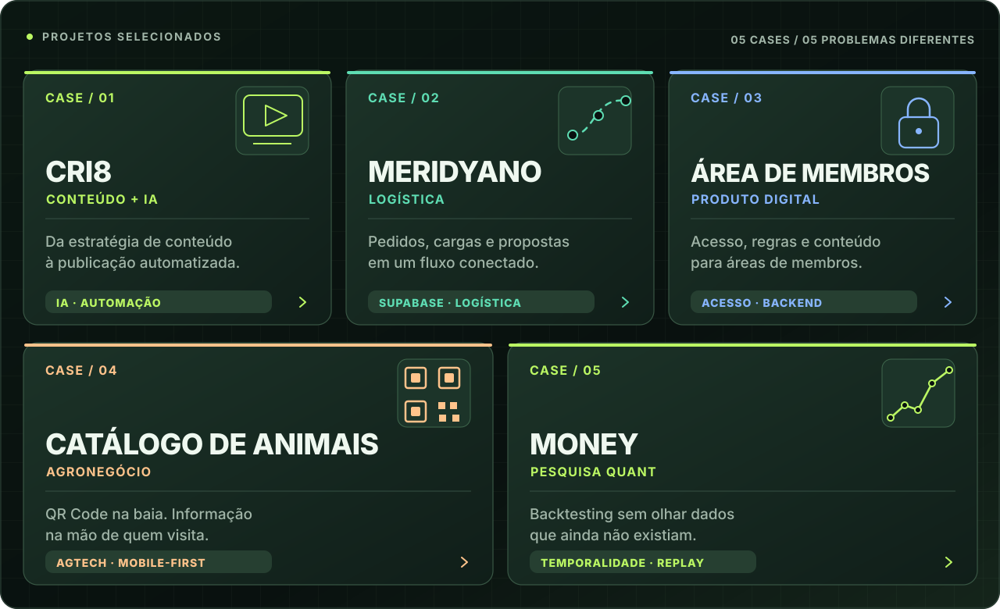
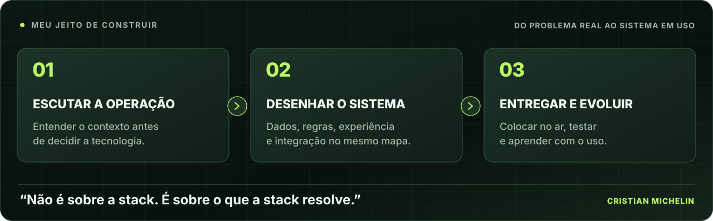
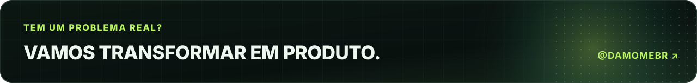

<!--
  Cristian Michelin — github.com/damomebr
  Identidade visual própria: grafite + verde-lima + menta.
  Os 10 arquivos SVG na pasta assets/ fazem parte deste README.
  Layouts específicos para desktop e celular. Nenhuma biblioteca ou script necessário.
-->

<picture>
  <source media="(max-width: 700px)" srcset="assets/hero-mobile.svg" />
  
</picture>

 
 

 
 

**Construo produtos digitais a partir de problemas que conheço de perto.**

 

## A operação veio antes do código.

Minha experiência com vendas, logística e agronegócio mudou minha forma de desenvolver software. Antes de escolher uma tecnologia, procuro entender **onde o processo trava, o que precisa acontecer e quem vai usar o sistema**.

Hoje conecto essa visão de negócio com desenvolvimento web, arquitetura de dados, integrações e inteligência artificial. Gosto de levar uma ideia até o ponto em que ela deixa de ser uma apresentação e passa a fazer parte da operação.

<picture>
  <source media="(max-width: 700px)" srcset="assets/areas-mobile.svg" />
  
</picture>

 

## Trabalhos selecionados

Projetos em áreas diferentes. Um mesmo ponto de partida: o problema real.

 
 

<picture>
  <source media="(max-width: 700px)" srcset="assets/cases-mobile.svg" />
  
</picture>

 

**[Cri8](https://github.com/damomebr/cri8-case-study)** &nbsp;·&nbsp;
**[Meridyano](https://github.com/damomebr/meridyano-case-study)** &nbsp;·&nbsp;
**[Membros](https://github.com/damomebr/member-platform-case-study)** &nbsp;·&nbsp;
**[AgTech](https://github.com/damomebr/livestock-catalog-case-study)** &nbsp;·&nbsp;
**[Money](https://github.com/damomebr/temporal-replay-case-study)**

 

<b>↳ Ver o problema e a solução de cada projeto</b>

 

### 01 / Cri8 — conteúdo com IA

**O desafio:** transformar estratégia e planejamento editorial em conteúdo publicado, preservando a linguagem da marca e a revisão humana.

**A abordagem:** uma aplicação que conecta estratégia, geração de conteúdo, automações, integrações externas e publicação no Instagram.

**Foco técnico:** IA aplicada · Integrações · Automação de processos.

[Ver o estudo de caso ↗](https://github.com/damomebr/cri8-case-study)

---

### 02 / Meridyano — logística e pedidos

**O desafio:** ofertas, pedidos, cargas e propostas fragmentados, com uma jornada originalmente construída em FlutterFlow que precisava acompanhar um fluxo mais complexo.

**A abordagem:** reorganização da experiência e das regras do negócio, utilizando Supabase como fonte central de dados e políticas de acesso.

**Foco técnico:** Supabase · PostgreSQL · RLS · Modelagem de fluxos.

[Ver o estudo de caso ↗](https://github.com/damomebr/meridyano-case-study)

---

### 03 / Plataforma de membros — acesso e experiência

**O desafio:** adaptar uma plataforma existente às necessidades reais de uma operação de membros.

**A abordagem:** regras próprias de acesso, estrutura de dados e funcionalidades para a jornada entre compra, conteúdo, progresso e renovação.

**Foco técnico:** Controle de acesso · Backend · Regras de negócio.

[Ver o estudo de caso ↗](https://github.com/damomebr/member-platform-case-study)

---

### 04 / Catálogo de animais — tecnologia no campo

**O desafio:** informações importantes sobre animais dispersas entre papel, planilhas e pessoas.

**A abordagem:** catálogo digital para consulta pelo celular, acesso por QR Code nas baias e painel administrativo de gestão.

**Foco técnico:** AgTech · QR Code · Aplicações mobile-first.

[Ver o estudo de caso ↗](https://github.com/damomebr/livestock-catalog-case-study)

---

### 05 / Money — pesquisa quantitativa

**O desafio:** testar estratégias financeiras sem contaminar decisões passadas com dados que só estariam disponíveis no futuro.

**A abordagem:** estudo de simulação temporal, rastreabilidade e experimentos reproduzíveis para pesquisa e paper trading.

**Foco técnico:** Dados temporais · Backtesting · Simulação.

[Ver o estudo de caso ↗](https://github.com/damomebr/temporal-replay-case-study)

 

## Como construo

O software é consequência de compreender o problema.

 
 

<picture>
  <source media="(max-width: 700px)" srcset="assets/metodo-mobile.svg" />
  
</picture>

 

## Ferramentas de trabalho

**Desenvolvimento e dados**

 
 

**Infraestrutura e colaboração**

 
 

 
 

## Entre em contato

Quer conversar sobre tecnologia, produto ou uma operação que precisa evoluir?

 

 
 

<picture>
  <source media="(max-width: 700px)" srcset="assets/footer-mobile.svg" />
  
</picture>

