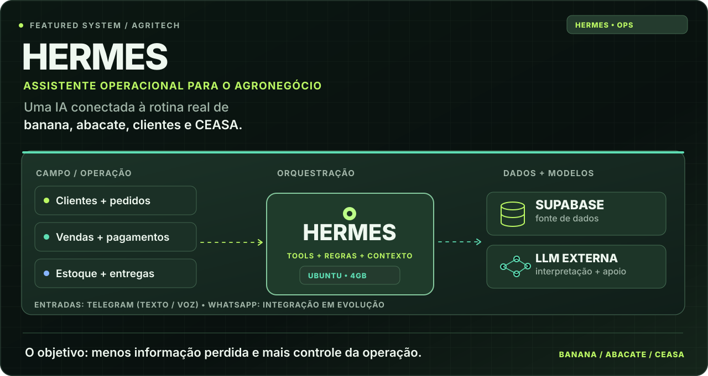
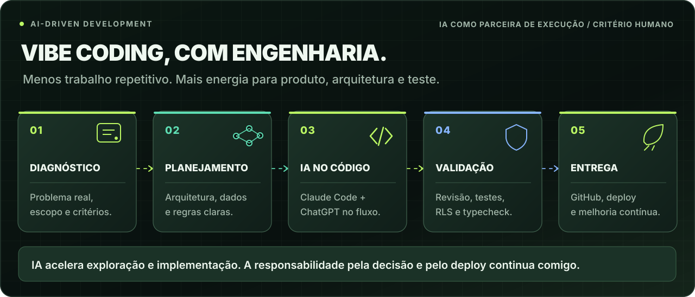

<!--
  Cristian Michelin · @damomebr · Profile README
  Identidade: grafite, verde-lima, menta, tipografia técnica.
  Os arquivos da pasta assets/ são necessários para exibir os cartões visuais.
  Os cartões têm versões independentes para desktop e celular.
  Não são exibidos dados internos, números de clientes ou credenciais.
-->

<picture>
  <source media="(max-width: 700px)" srcset="assets/hero-mobile.svg" />
  
</picture>

 
 

 
 

**Construo software com inteligência artificial para resolver problemas que conheço de perto.**

Empreendedor · Full-stack builder · AI-driven development

 

## O negócio vem antes da tecnologia.

Sou o Cristian. Divido meu tempo entre **operação agrícola, desenvolvimento de produtos digitais e inteligência artificial**. Trabalho com comercialização e distribuição de frutas, principalmente banana e abacate, e levo para o software as mesmas perguntas que aparecem no dia a dia: onde o pedido ficou parado? O estoque está correto? Qual cliente precisa de retorno? Como diminuir trabalho manual sem perder controle?

Não comecei pelo desejo de colocar IA em tudo. Comecei encontrando problemas que realmente custam tempo, dinheiro e oportunidades. Hoje uso **Claude Code, ChatGPT, desenvolvimento full-stack e integrações** para transformar esses problemas em aplicações, automações e sistemas próprios.

<picture>
  <source media="(max-width: 700px)" srcset="assets/areas-mobile.svg" />
  
</picture>

 

---

## 🌱 Hermes — IA dentro da operação agrícola

Meu principal laboratório não é um ambiente de demonstração. É uma operação que precisa vender, entregar e receber.

 
 

<picture>
  <source media="(max-width: 700px)" srcset="assets/hermes-mobile.svg" />
  
</picture>

### Por que construí o Hermes?

Na comercialização de banana e abacate, uma informação pode nascer na lavoura, mudar durante o carregamento e terminar em uma conversa com um comprador no CEASA. Nesse caminho existem **pedidos, volumes, clientes, preços, pagamentos, veículos, entregas e estoque**.

Se tudo depende de memória, mensagens espalhadas e anotações, a operação cresce mais rápido que o controle. O **Hermes** é a tentativa prática de resolver isso: um **assistente operacional ligado a dados reais**, que recebe informações em linguagem natural e utiliza ferramentas de software para consultar ou atualizar o sistema.

A ideia é simples: **eu falo como quem está trabalhando; o sistema precisa entender como a operação funciona.**

### Como uso na prática

| Situação na operação | Papel do Hermes |
|:--|:--|
| **Uma venda acontece** | Receber o relato, identificar produto/quantidade/cliente e encaminhar o registro para as ferramentas de venda. |
| **Preciso saber o estoque** | Consultar o estado registrado, em vez de depender de uma conta feita de cabeça. |
| **Vou organizar uma entrega** | Reunir os pedidos e os dados de clientes e entregas para consulta operacional. |
| **Um cliente pagou** | Associar o pagamento à venda e manter o histórico coerente. |
| **Quero analisar a semana** | Usar os registros de clientes, pedidos, vendas e entregas para preparar consultas e relatórios. |
| **Estou longe do computador** | Interagir com o assistente por **Telegram**, inclusive com mensagens de voz. |

**Exemplo ilustrativo de interação:** durante a rotina, eu poderia dizer no Telegram *“Registra a venda de oito caixas de banana para este cliente e marca como entrega de sexta”*. O assistente interpreta a solicitação, confere o contexto necessário e aciona as ferramentas de registro. **A IA interpreta; as regras e os dados pertencem ao sistema.** O exemplo mostra a lógica de uso, não uma garantia de que toda frase arbitrária já está coberta.

### O que existe por baixo da conversa

| Camada | Escolha técnica | Motivo |
|:--|:--|:--|
| **Servidor** | Notebook reaproveitado, **Ubuntu Server**, cerca de **4 GB de RAM** | Infraestrutura própria, leve e adequada a serviços de integração. |
| **Conectividade** | **Tailscale + SSH** | Administrar a infraestrutura remotamente sem depender de um IP público fixo. |
| **Interface operacional** | **Telegram (texto e áudio)** | Registrar e consultar informações sem abrir um painel em toda tarefa. |
| **Fonte de dados** | **Supabase / PostgreSQL** | Centralizar clientes, estoque, pedidos, entregas, vendas, pagamentos e histórico. |
| **Inteligência** | **LLMs externas** | O servidor executa integrações e ferramentas; o raciocínio do modelo não precisa rodar localmente. |
| **Canais comerciais** | **WhatsApp Business API** | Integração de relacionamento com clientes, com controles de autorização e envio. |

O Hermes não é só um chatbot respondendo perguntas. Seu desenho separa **linguagem natural**, **ferramentas operacionais**, **regras de negócio** e **fonte de dados**. Uma resposta simpática não substitui um registro correto. E uma automação comercial não deve enviar mensagens sem as condições e autorizações necessárias.

### Estado real do projeto

- **✅ Base operacional em uso:** dados centralizados, ferramentas para consultar/registrar informações comerciais e interface do Hermes por Telegram, incluindo texto e áudio.
- **🛠️ Em evolução:** expansão das integrações de WhatsApp, confirmação de pedidos, acompanhamento comercial e rotinas programadas; a API preparada **não significa que disparos automáticos para clientes estejam liberados**.
- **🧭 Próximas frentes:** melhorar relatórios e previsões, aprofundar o planejamento logístico e conectar mais dados de estoque e maturação ao fluxo da operação.

**O que mais me interessa no Hermes:** ele obriga a IA a lidar com consequências reais — estoque precisa bater, entrega tem horário, cliente espera resposta e pagamento precisa ser conciliado. Não é uma prova de conceito criada para uma apresentação.

 

---

## ⚡ Como uso IA para desenvolver software

Vibe coding não é apertar um botão e torcer. É reduzir o custo de transformar uma hipótese em algo testável.

 
 

<picture>
  <source media="(max-width: 700px)" srcset="assets/ai-development-mobile.svg" />
  
</picture>

### Minha rotina de AI-driven development

**01 · Começo pelo problema, não pelo prompt.**  
Descrevo o fluxo real, as pessoas envolvidas, os casos de erro e o resultado esperado. Muitas vezes esse contexto nasce de uma operação que eu mesmo acompanho: um carregamento, uma venda, um pedido ou uma integração que precisa funcionar.

**02 · Uso IA para explorar caminhos e questionar decisões.**  
No **ChatGPT**, trabalho hipóteses, requisitos, trade-offs de arquitetura, modelagem de dados e o que deve ou não ser automatizado. A IA também me ajuda a revisar especificações e antecipar casos que a primeira ideia não contemplou.

**03 · Desenvolvo dentro do projeto, não fora dele.**  
Com **Claude Code** e ferramentas de desenvolvimento, levo essas decisões para o repositório: componentes React, rotas, integrações, lógica de negócio, migrações e ajustes de infraestrutura. O contexto do projeto importa mais que receber um trecho de código isolado.

**04 · Faço a IA confrontar o próprio trabalho.**  
Peço revisão de implementação, investigação de bugs, casos extremos e propostas de teste. Em sistemas com Supabase, presto atenção especial a **RLS, autenticação, permissões e regras do banco**. Teste automatizado e typecheck têm mais peso que uma resposta dizendo “pronto”.

**05 · Integro, publico, uso e corrijo.**  
O ciclo fecha com **Git/GitHub, deploy, observação do comportamento e iteração**. Prefiro entregar um fluxo pequeno que possa ser verificado de ponta a ponta a acumular funcionalidades que ninguém conseguiu testar.

> **A IA aumenta minha capacidade de execução; não terceiriza minha responsabilidade sobre o produto.**

### Um exemplo concreto: onboarding de uma plataforma de membros

Em um projeto próprio de comunidade, a **Vibe Coding Society**, trabalhei um fluxo completo de convite e iniciação. O desafio não era apenas desenhar telas: era garantir que a pessoa certa entrasse, respondesse uma sequência e que o acesso tivesse estados verificáveis.

A implementação envolveu **tokens de convite, validação de JWT, derivação de ticket, regras de abertura/conclusão e interface em React**. No ciclo documentado desse fluxo, a entrega passou por **271 testes aprovados, typecheck limpo e deploy na Vercel**. Esse é o tipo de combinação que procuro: rapidez na construção com verificações concretas sobre o comportamento do sistema.

Não publico código, segredos ou dados de cliente que precisem permanecer privados. Quando o código não pode ser aberto, procuro documentar **o problema, as decisões e os limites da solução**.

### Onde a IA entra, e onde ela não decide sozinha

| Uso IA para acelerar | Mantenho sob critérios explícitos |
|:--|:--|
| Explorar soluções e alternativas | Prioridade do negócio e requisitos reais |
| Rascunhar e implementar código | Permissões, segurança e acesso a dados |
| Investigar bugs e propor testes | Decisão de publicar ou reverter mudanças |
| Ler documentação e comparar abordagens | Veracidade das informações e resultados |
| Automatizar tarefas repetitivas | Autorização para ações externas e mensagens |

**Ferramentas centrais do meu fluxo:** ChatGPT · Claude Code · GitHub · React / Next.js · TypeScript · Supabase · Vercel · Ubuntu Server.

 

---

## 🚀 Outros trabalhos selecionados

Aplicações diferentes, a mesma preocupação: conectar software a uma necessidade concreta.

 
 

<picture>
  <source media="(max-width: 700px)" srcset="assets/cases-mobile.svg" />
  
</picture>

 

**[Cri8](https://github.com/damomebr/cri8-case-study)** &nbsp;·&nbsp;
**[Meridyano](https://github.com/damomebr/meridyano-case-study)** &nbsp;·&nbsp;
**[Membros](https://github.com/damomebr/member-platform-case-study)** &nbsp;·&nbsp;
**[AgTech](https://github.com/damomebr/livestock-catalog-case-study)** &nbsp;·&nbsp;
**[Money](https://github.com/damomebr/temporal-replay-case-study)**

 

<b>↳ Abrir detalhes técnicos dos cinco projetos</b>

 

### 01 / Cri8 — da estratégia ao conteúdo

**Problema.** O planejamento editorial frequentemente termina em uma apresentação ou documento. Entre a ideia, o tom da marca, a revisão e a publicação, existe um processo manual que consome tempo.

**Solução.** Aplicação que conecta estratégia, geração assistida por IA, orquestração e integração com ferramentas externas. O case documenta **API da Claude para a conversa estratégica, Gemini para imagens, n8n para automações e Instagram API/OAuth para publicação**, além de autenticação e dados no Supabase. A operação atual dessas integrações requer validação.

**O que o case demonstra.** Orquestração de etapas, contexto de marca, integrações e distinção entre geração automática e decisão editorial.

`IA generativa` `Automações` `APIs` `Fluxo editorial`

[Estudo de caso ↗](https://github.com/damomebr/cri8-case-study)

---

### 02 / Meridyano — pedido encontra transporte

**Problema.** Oferta, pedido, carga e proposta compõem uma jornada, mas podem ficar em sistemas e interfaces separados. O fluxo original em FlutterFlow exigia revisão para acompanhar regras mais complexas.

**Solução.** Reconstrução da experiência e da organização das regras de negócio com **Supabase como referência central**, incluindo controle de acesso por RLS e modelagem das entidades operacionais.

**O que o case demonstra.** Transformação de um processo comercial complexo em estados, relacionamentos, interfaces e permissões consistentes.

`Logística` `Supabase` `PostgreSQL` `RLS`

[Estudo de caso ↗](https://github.com/damomebr/meridyano-case-study)

---

### 03 / Plataforma de membros — da compra ao acesso

**Problema.** Uma plataforma de membros existente precisava representar as particularidades de uma operação: regras próprias de acesso, jornada de conteúdo e funções que não cabiam em um template genérico.

**Solução.** Personalização de banco, acesso, experiência e lógica de operação ao longo da jornada **compra → acesso → conteúdo → progresso → renovação**.

**O que o case demonstra.** Regras de negócio e experiência de usuário trabalhando juntas: o estado do pedido determina a matrícula e o acesso, com políticas de segurança no banco e revogação quando necessária. A plataforma-base (Hubfy Lite) é creditada como origem da adaptação.

`Controle de acesso` `Backend` `React` `Regras de negócio`

[Estudo de caso ↗](https://github.com/damomebr/member-platform-case-study)

---

### 04 / Catálogo de animais — informação no lugar certo

**Problema.** Em uma exposição ou rotina rural, os dados de um animal podem estar no papel, numa planilha ou apenas com a pessoa responsável — longe de quem está precisando consultar.

**Solução.** Catálogo digital **mobile-first**, com QR Code para acesso no local e painel administrativo para organizar animais e informações.

**O que o case demonstra.** Tecnologia pensada para o ambiente de uso, reduzindo etapas entre a pergunta e o dado que responde.

`AgTech` `QR Code` `Mobile-first` `Catálogo`

[Estudo de caso ↗](https://github.com/damomebr/livestock-catalog-case-study)

---

### 05 / Money — pesquisa sem olhar o futuro

**Problema.** Uma estratégia financeira pode parecer excelente em backtesting se receber, sem perceber, dados que só seriam conhecidos depois da decisão simulada.

**Solução.** Ambiente de pesquisa e simulação que distingue o horário de um evento (`event_time`) do momento em que o sistema recebeu a informação (`received_at`). O replay só expõe aquilo que já era conhecido no instante simulado, com foco em reprodutibilidade e paper trading sem ordens reais.

**O que o case demonstra.** A importância de experimentos reproduzíveis e de regras claras de causalidade no desenvolvimento de sistemas orientados por dados.

`Pesquisa quantitativa` `Simulação` `Backtesting` `Dados temporais`

[Estudo de caso ↗](https://github.com/damomebr/temporal-replay-case-study)

 

---

## 🧭 Como eu penso produto

Entender o contexto → explicitar as regras → desenvolver → validar → aprender com o uso.

 
 

<picture>
  <source media="(max-width: 700px)" srcset="assets/metodo-mobile.svg" />
  
</picture>

Não tenho interesse em adicionar IA a um processo apenas para poder dizer que ele tem IA. Às vezes a melhor solução é uma regra simples, uma consulta confiável, um formulário bem desenhado ou um bom fluxo de autorização. **Automatizo quando há benefício real, e mantenho uma pessoa na decisão quando o risco pede isso.**

 

## 🛠️ Stack & ferramentas

**Aplicações e dados**

 
 

**Infraestrutura e desenvolvimento**

 
 

 
 

## 📫 Vamos conversar

**Tem um problema de negócio que precisa virar um sistema de verdade?**

Gosto de conversar sobre produtos digitais, IA aplicada, operações e arquitetura de software.

 

 
 

<picture>
  <source media="(max-width: 700px)" srcset="assets/footer-mobile.svg" />
  
</picture>

