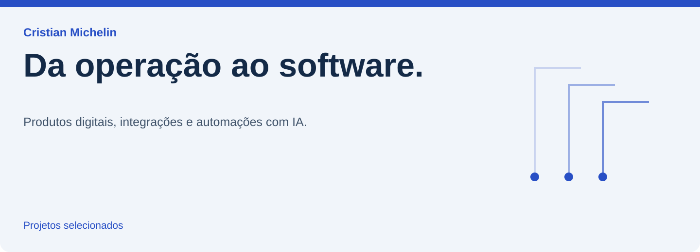

<picture>
  <source media="(max-width: 640px)" srcset="assets/profile-mobile.svg">
  
</picture>

Meu trabalho reúne produtos digitais, integrações e automações com IA. Este portfólio apresenta projetos em conteúdo, agronegócio, educação e engenharia de dados, com atenção aos fluxos de negócio e às decisões técnicas.

## Projetos selecionados

### [Cri8](https://github.com/damomebr/cri8-case-study)

**Da estratégia à publicação.** IA, automação e integrações externas reunidas em uma aplicação de conteúdo. O case acompanha o caminho entre a conversa estratégica e a publicação no Instagram.

### [Meridyano](https://github.com/damomebr/meridyano-case-study)

**O pedido encontra o frete.** Reconstrução de uma interface originalmente feita em FlutterFlow, conectando ofertas, pedidos, cargas e propostas de transporte a um banco Supabase.

### [Plataforma de membros](https://github.com/damomebr/member-platform-case-study)

**Da compra ao conteúdo.** Implantação e adaptação de uma plataforma baseada no Hubfy Lite, com banco próprio, regras de acesso e funções para integrar a operação.

### [Catálogo de animais](https://github.com/damomebr/livestock-catalog-case-study)

**A baia vira ponto de acesso.** Catálogo público e painel administrativo para conectar animais, baias e exposições. O visitante acessa a informação pelo celular no lugar em que ela é necessária.

### [Money](https://github.com/damomebr/temporal-replay-case-study)

**O teste não pode ver o futuro.** Pesquisa quantitativa e paper trading com uma regra temporal explícita: cada decisão só pode acessar o que o sistema já conhecia naquele instante.

## O que os cases mostram

- Integração entre interface, dados e serviços externos.
- Regras de acesso e fluxos que conectam etapas de uma operação.
- Adaptação de sistemas existentes e reconstrução de jornadas.
- Pesquisa com resultados reproduzíveis e limites explícitos.

## Tecnologias presentes nos projetos

TypeScript · React · Next.js · Python · Supabase · PostgreSQL · n8n · APIs de IA

Os cases públicos documentam o problema, a arquitetura e o escopo. O código das aplicações permanece privado.
